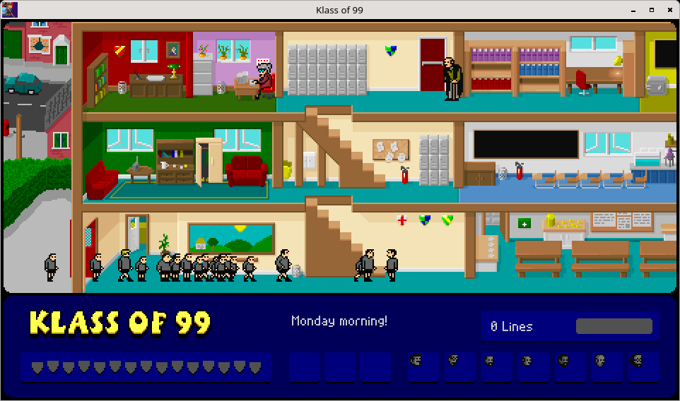
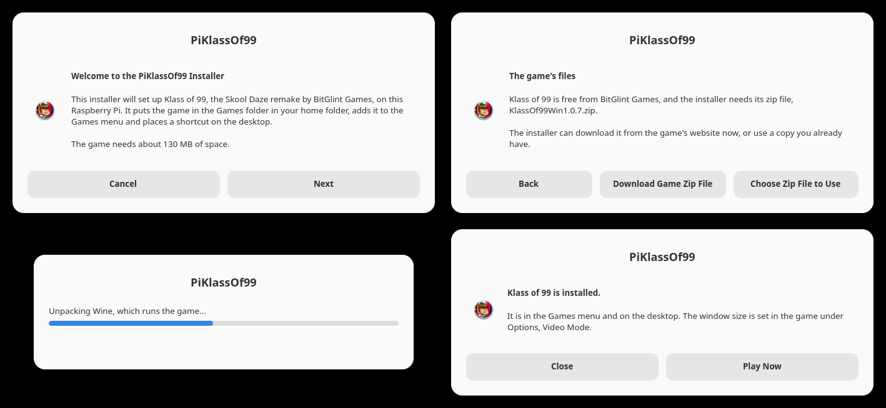

<p align="center"></p>

<h1 align="center">PiKlassOf99</h1>

<p align="center"><b>Klass of 99 on the Raspberry Pi.</b><br>A friendly installer that sets up Richard Jordan's Skool Daze remake on a Pi 4, 400, 5 or 500, ready to play from the Games menu.</p>

<p align="center"><a href="../../releases/latest"><b>Download for Raspberry Pi OS</b></a></p>



## What it does

[Klass of 99](https://bitglint.itch.io/klassof99) is a free Windows game by Richard Jordan of BitGlint Games, a follow-up and tribute to the Skool Daze games of the 1980s. PiKlassOf99 installs it on a Raspberry Pi. The installer gets the game from its own website, adds a small copy of Wine that runs this one game, and puts Klass of 99 in the Games menu and on the desktop.

The whole install is 130 MB in one folder in your home folder.

## The original game

Klass of 99 is the work of Richard Jordan. He wrote it after Spectrum fans on comp.sys.sinclair named Skool Daze as the game they most wanted to see remade.

**The original game is at [bitglint.itch.io](https://bitglint.itch.io/).** Its own page, [bitglint.itch.io/klassof99](https://bitglint.itch.io/klassof99), has the Windows download this installer uses, `KlassOf99Win1.0.7.zip`, and the story that goes with the game as a second download.

PiKlassOf99 is an unofficial installer and is not affiliated with BitGlint Games. It contains none of the game's files. The installer downloads the zip from that page, or uses a copy you downloaded from there yourself.

## Features

- **A proper installer.** Four screens and a progress bar, built from the dialogs Raspberry Pi OS already has. No terminal needed.
- **Gets the game for you.** It downloads `KlassOf99Win1.0.7.zip` from the game's [itch.io page](https://bitglint.itch.io/klassof99). A copy placed next to the installer is used without asking, and any other copy can be chosen by hand.
- **Small.** A stock Wine install for this game takes 2.4 GB plus a 2.3 GB prefix. This one is trimmed to the files the game opens, 123 MB in all.
- **Self-contained.** Everything lives in `Games/KlassOf99`. Nothing is installed system-wide and no packages are added.
- **Ready for the Pi 5 and Pi 500.** Wine needs a kernel with 4K memory pages, and the installer switches the Pi to the one it already has.
- **Closes like any other window.** The close button and Alt+F4 leave the game and keep your settings. The game on its own takes no notice of either.
- **Reinstall or remove.** Run the installer again. Reinstalling keeps your saved settings.



## Install

1. Download `PiKlassOf99.tar.gz` from the [latest release](../../releases/latest) and extract it. In the file manager, right-click the file and choose Extract Here.
2. Open the `PiKlassOf99` folder, double-click `install.sh` and choose Execute.
3. Follow the screens. Choose **Download Game Zip File** to have the installer fetch the game, or **Choose Zip File to Use** if you have downloaded it already.

From a terminal the same thing is:

```bash
tar -xzf PiKlassOf99.tar.gz && PiKlassOf99/install.sh
```

| Raspberry Pi | Notes |
| --- | --- |
| Pi 4 and Pi 400 | Installs and runs as it is. |
| Pi 5 and Pi 500 | The installer first switches the Pi to its 4K kernel by adding three lines to `/boot/firmware/config.txt`. Restart, then run the installer again. |

It needs 64-bit Raspberry Pi OS 13 (trixie) or newer with the desktop, and 200 MB of free space.

## Playing

Start Klass of 99 from the Games menu or the desktop. Eric moves with the cursor keys or Q, A, O and P.

| Key | Action | Key | Action |
| --- | --- | --- | --- |
| S | Sit down or stand up | F | Fire the catapult |
| H | Hit | J | Jump |
| W | Write on a blackboard | T | Type on the computer |
| C | Pick up an object | D | Drop a crystal |
| B | Drop a bomb | 1 | Pause |

The window size is set in the game under Options, Video Mode.

## How it works

Klass of 99 is a 32-bit Windows program. It runs under [Hangover](https://github.com/AndreRH/hangover), a build of Wine for ARM64 that emulates only the game's own x86 code with Box64 and runs everything else natively.

`runtime.tar.xz` holds that Wine, cut down to this game. Hangover ran the game under `strace`, and only the files it opened were kept, with the debug data removed from each DLL. The Wine prefix keeps its registry and folders, and its DLLs are links into the same Wine. The machine that built it leaves no trace in it, so it works for any user in any home folder. Its registry has Wine take keyboard focus from the window manager the plain way (`UseTakeFocus` set to `N`). With Wine's default, the Pi's desktop now and then never passed the keyboard to the game.

Klass of 99 only leaves through Quit on its title screen. Its engine marks the window as having no close, and Wine drops a close request for a window like that, so the close button and Alt+F4 never reach the game. `Closer.exe` starts the game and loads `Closer.dll` into it, both built from `tools/closer.c`. The DLL allows closing again. When the window is asked to close, it presses the game's own keys for you, Escape and then Y at "Do you really want to quit?", until Escape at the title screen quits. That is the way out on which the game saves its settings. A game still running a few seconds later is ended.

## Building the runtime

This is only needed for a newer Hangover. It takes a Pi with a 4K kernel and 6 GB free.

```bash
mkdir -p ~/ko99-build/game && cd ~/ko99-build
wget https://github.com/AndreRH/hangover/releases/download/hangover-11.16/hangover_11.16_debian13_trixie_arm64.tar
tar -xf hangover_11.16_debian13_trixie_arm64.tar
mkdir root && for d in hangover-wine*.deb hangover-wowbox64*.deb; do dpkg-deb -x "$d" root; done
```

Unzip the game into `~/ko99-build/game`, create a full prefix, then record what the game opens while you visit the menu and the options and play for a minute:

```bash
export WINEPREFIX=$HOME/ko99-build/prefix-full WINEDLLOVERRIDES="mscoree=d;mshtml=d"
W=$HOME/ko99-build/root/usr/bin
$W/wine wineboot --init; $W/wineserver -k
cd ~/ko99-build/game
strace -f -y -qq -e trace=openat,open,execve -o ~/ko99-build/trace1.log $W/wine KO99.exe
```

`tools/build-runtime.sh` then trims Hangover to the traced files, and `tools/pack-runtime.sh ~/ko99-build/runtime` writes `runtime.tar.xz`. `Closer.exe` and `Closer.dll` are rebuilt with `tools/build-closer.sh`, which needs [zig](https://ziglang.org) and runs on any machine.

A release is the installer, the runtime, the close helper, the icon and the licence in one archive:

```bash
git archive --format=tar.gz --prefix=PiKlassOf99/ -o PiKlassOf99.tar.gz HEAD install.sh runtime.tar.xz Closer.exe Closer.dll icon.png LICENSE
```

## Pi Projects

PiKlassOf99 is one of three projects for the Raspberry Pi. One is a utility for the desktop, and two bring favourite old freeware games to the Pi with the same kind of installer.

| Project | What it is |
| --- | --- |
| [PiOSBeachBall](https://github.com/jameshansen/PiOSBeachBall) | A spinning beachball pointer that shows when an app is loading. |
| [PiKnytt](https://github.com/jameshansen/PiKnytt) | Knytt, the 2006 exploration platformer by Nifflas, installed and ready to play. |
| **PiKlassOf99** | Klass of 99, Richard Jordan's Skool Daze remake, installed and ready to play. |

## AI use disclosure

PiKlassOf99 was built using [Claude Code](https://claude.com/claude-code) with Claude Fable 5.2.

## Credits

Klass of 99 was designed and programmed by Richard Jordan and is published by [BitGlint Games](https://bitglint.itch.io/). Graham Goring designed the school and wrote the story, Matt Simmonds wrote the music and the sound effects, Carl Murray compiled the questions and tested the game, and John Blythe drew the cartoons. The game is freeware, remains the copyright of BitGlint Games and is not included here. The icon is cut from the game's title artwork.

The runtime is built from [Hangover](https://github.com/AndreRH/hangover) 11.16 by André Zwing and contributors, which combines [Wine](https://www.winehq.org) (LGPL 2.1 or later) with [Box64](https://github.com/ptitSeb/box64) by ptitSeb (MIT). Source for those binaries is at the Hangover 11.16 tag.

## Licence

The installer, the close helper and the build scripts are free software under the [MIT licence](LICENSE). The Wine and Box64 binaries in `runtime.tar.xz` keep their own licences, named above.
